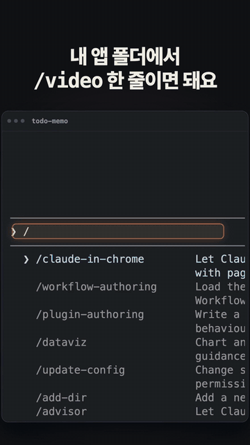
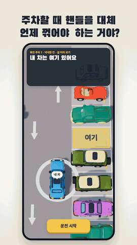
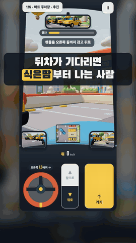
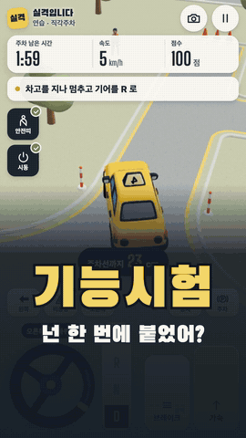
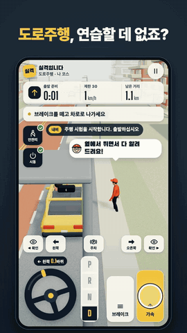
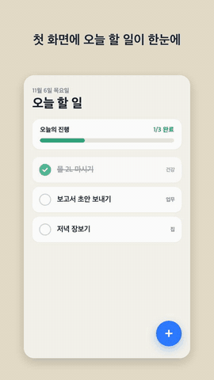
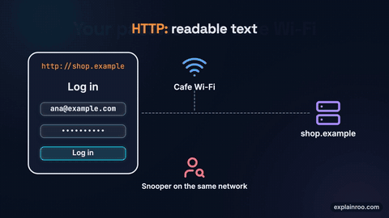

# 영상 감독실 (claude-video-studio)

<p align="center"><br><sub>이 홍보 릴스도 영상 감독실로 만들었어요</sub></p>

**"어떤 영상이 필요해요?" 한 줄이면, 맞는 영상 도구를 골라 계획 → 제작 → 소리 → 검사 → 완성까지 진행 보드로 보여 주는 한국어 Claude Code mod.**


> English: A Korean-language Claude Code mod that acts as a video director. Describe the video you need in one line; it picks the right video skill (huashu-motion, take-one, Argo, explainroo, rossark-motion-skill, reanimate, earshot, real-sound, watch, video-director, Kling), shows a progress board (plan → make → sound → check → done), blocks paid generation until you approve the cost, and measures the finished MP4 with `qa_video` and `earshot critique`.

## 영상 감독실로 만든 영상

모두 영상 감독실로 만든 실제 결과물이에요. 각 영상의 앞부분 7초 안팎을 GIF로 줄였어요(소리 없음). 따로 적지 않은 것은 huashu-motion 으로 만들었어요.

<table>
<tr><td align="center" valign="top"><br><b>주차왕</b><br><sub>후진 주차 홍보 릴스 · 30초</sub></td><td align="center" valign="top"><br><b>주차왕</b><br><sub>「뒤차가 기다리면」 릴스 · 32초</sub></td><td align="center" valign="top"><br><b>실격입니다</b><br><sub>기능시험 스레드 영상 · 18초</sub></td><td align="center" valign="top"><br><b>실격입니다</b><br><sub>도로주행 소개 · 28초</sub></td></tr>
<tr><td align="center" valign="top"><br><b>다이노밸리</b><br><sub>공룡 골짜기 홍보 릴스 · 27초</sub></td><td align="center" valign="top"><br><b>다이노밸리</b><br><sub>직접 걸어 본 데모 · 30초 (Argo)</sub></td><td align="center" valign="top"><br><b>매일 소원 빌기</b><br><sub>홍보 릴스 · 20초</sub></td><td align="center" valign="top"><br><b>앉아가요</b><br><sub>지하철 자리 앱 홍보 릴스 · 25초</sub></td></tr>
<tr><td align="center" valign="top"><br><b>할 일 앱</b><br><sub>눌러 가며 찍은 데모 · 30초 (Argo, 사람 손 없이)</sub></td><td align="center" valign="top"><br><b>마스코트</b><br><sub>앱 속 대기 애니메이션 · 3초 반복 (rossark-motion-skill, 사람 손 없이)</sub></td></tr>
</table>

<table><tr><td align="center" valign="top"><br><b>다이노밸리</b><br><sub>가로 소개 영상 · 30초</sub></td><td align="center" valign="top"><br><b>영어 설명 영상</b><br><sub>공용 와이파이와 HTTPS · 33초 (explainroo)</sub></td></tr></table>

## 무엇을 해 주나

영상 스킬은 많은데, 요청마다 어떤 걸 써야 할지, 어디까지 됐는지, 돈은 드는지, 완성본이 괜찮은지 매번 따로 챙겨야 해요. 영상 감독실은 그걸 한곳에 모아요.

| 화면 | 하는 일 |
|---|---|
| **옆 패널 「영상 감독실」** | 첫 화면은 질문 하나: "어떤 영상이 필요해요?" + 최근 프로젝트 3개 |
| **추천 카드** | 고른 도구, 이유 한 줄, 예상 시간, 비용(무료/유료 항목별), 크기(9:16 등), 한국어 목소리·글꼴 주의 |
| **진행 보드** | 계획 → 제작 → 소리 → 검사 → 완성 5단계, 단계별 메모·파일, 검사 배지(`qa ✓12 ⚠3 ✗0 · 소리 거의 됨 0.91`) |
| **비용 문** | Kling·ElevenLabs·OpenAI TTS·이미지 모델 호출은 [허락]을 누르기 전엔 막혀요 |
| **입력창 위 띠** | `9: 🎬 영상 감독실 · 제작 중 · 5단계 중 2단계 끝 · 다음: …` |
| **자동 검사** | 완성된 MP4를 `qa_video`(글자 크기·대비·번쩍임·컷 등)와 `earshot critique`(음량·소리 싱크)로 직접 재요 |

> **빠른 시작:** `/plugin marketplace add robinade/claude-video-studio` → `/plugin install video-studio@claude-video-studio` → **`/reload-plugins`** → `/video 우리 앱 홍보 릴스 20초`

이 mod는 영상 도구를 새로 만들지 않아요. 이미 공개된 영상 스킬들을 **고르고, 순서대로 시키고, 검사하는** 감독 역할이에요.

## 쓰는 법

```
/video 우리 앱 홍보 릴스 20초 9:16
```

추천 카드에서 `1`(시작)을 누르면 끝이에요. 채팅으로 그냥 "영상 만들어 줘"라고 해도 같은 보드로 진행해요.

| 명령 | 하는 일 |
|---|---|
| `/video <요청>` | 추천 카드 열기 |
| `/video --auto <요청>` | 카드 없이 바로 무인 진행(돈 드는 단계는 자동 거절) |
| `/video-status` | 지금 프로젝트의 단계·검사 점수 |
| `/video-qa <파일>` | 영상 파일 하나를 qa_video + earshot 으로 검사 |
| `/video-open` | 결과 폴더 열기 |

단축키는 모두 숫자라서 한글 입력 상태에서도 먹어요. 자세한 화면 설명과 판정 결과는 [`video-studio/README.md`](video-studio/README.md)에 있어요.

## 함께 설치되는 것

영상 감독실을 설치하면 **영상 도구 9종이 플러그인으로 함께 설치돼요**(Kling 제외). 따로 설치할 필요가 없어요. 각 도구는 원작 저장소의 특정 커밋으로 고정해서, 원작이 바뀌어도 검증 안 된 코드가 자동으로 들어오지 않아요.

| 도구 | 이럴 때 고름 | 원작 저장소 | 고정한 커밋 |
|---|---|---|---|
| huashu-motion | 앱 홍보·런칭 영상, 음악 박자 모션그래픽, 데이터 영상, 한국어 내레이션 | [alchaincyf/huashu-motion](https://github.com/alchaincyf/huashu-motion) | `52467f9` |
| take-one | 이야기형 광고, 브랜드 필름, 뮤직비디오 | [talsiach/take-one](https://github.com/talsiach/take-one) | `830621c` |
| argo-guide | 실제 앱을 자동으로 눌러 가며 녹화한 데모 | [shreyaskarnik/argo](https://github.com/shreyaskarnik/argo) | `5f71549` |
| explainroo | 영어 주제 설명 영상(대본·목소리·그림·자막 자동) | [vincentsch/explainroo](https://github.com/vincentsch/explainroo) | `e95232c` |
| rossark-motion-skill | 앱 속 마스코트·아이콘 애니메이션 | [rossark0/rossark-motion-skill](https://github.com/rossark0/rossark-motion-skill) | `9b20964` |
| reanimate | 남의 사이트·영상 애니메이션을 내 코드로 복제 | [NiazMorshed2007/reanimate](https://github.com/NiazMorshed2007/reanimate) | `3f7a55a` |
| earshot (+ real-sound) | 효과음·음량·소리 싱크, 실제 녹음 음원 사운드트랙 | [Leonxlnx/earshot](https://github.com/Leonxlnx/earshot) | `591fa3e` |
| watch | 참고 영상 분석(컷·훅·구성) | [bradautomates/claude-video](https://github.com/bradautomates/claude-video) | `03ceb42` |
| video-director | 계획표 검사, 완성본 측정 검사 | [win4r/video-director](https://github.com/win4r/video-director) | `4747e5c` |

Kling(실사 장면 생성, 유료)은 함께 설치하지 않아요. 쓰려면 Kling MCP를 따로 연결하세요. 영상 감독실은 Kling 호출을 허락 전까지 막아요.

### 첫 실행 때 자동 준비

스킬 파일만으로는 돌지 않는 도구가 있어요(파이썬 환경, 소리 모델, npm 패키지 등). 영상 감독실을 설치하고 **처음 Claude Code를 켜면, 뒤에서 아래를 자동으로 설치해요.** 입력창 위 띠에 진행이 보이고, 끝나면 알림이 떠요. 이미 있는 것은 건너뛰어요.

| 준비물 | 설치 위치 | 대략 크기 |
|---|---|---|
| ffmpeg·ffprobe (없을 때만) | Homebrew | — |
| 자동 검사용 파이썬(numpy·Pillow) | `~/video-studio/tools/py` | 60MB |
| earshot 명령 + 소리 모델 2개 | `~/video-studio/tools/earshot`, `~/.local/bin/earshot` | 2.4GB |
| explainroo 명령 + 목소리 모델 | `~/.explainroo` | 1GB |
| reanimate 스크립트 의존성 + Chromium | 플러그인 폴더 안, Playwright 캐시 | 700MB |

macOS 에 아무것도 없는 상태에서 다 받으면 모두 약 4GB, 만든 사람 컴퓨터에서 시험했을 때 약 5분 걸렸어요. 인터넷이 느리면 더 걸려요. 그동안에도 영상 감독실과 다른 도구는 쓸 수 있어요.

- 상황 보기: `/video-setup` · 지금 다시 준비: `/video-setup run` · 기록: `~/video-studio/tools/prepare.log`
- 자동 준비를 끄려면 환경 변수 `VIDEO_STUDIO_PREPARE=0`
- 필요한 것: macOS(Homebrew 권장), Python 3.10 이상, Node.js 20.11 이상. bun 이 없으면 Homebrew 로 설치해요.
- huashu-motion 악기 샘플, take-one·watch·Argo 의 선택 항목은 각 스킬이 처음 쓸 때 스스로 준비해요.
- 결과 영상은 모두 `~/video-studio/projects/<날짜-시각-도구>/` 에 모여요.
- 같은 도구를 다른 곳에서 이미 설치했다면(예: `argo-guide@argo-video`) 스킬이 두 벌 보일 수 있어요. 한쪽을 끄면 돼요: `claude plugin disable argo-guide@argo-video`

## 설치

### AI 에이전트에게 맡기기

아래를 Claude Code에 붙여 넣으면 설치부터 확인까지 해 줘요.

```
영상 감독실 Claude Code mod를 설치해 줘. 저장소는 https://github.com/robinade/claude-video-studio 야.

아래 순서대로 진행해 줘.
1. `claude plugin marketplace add robinade/claude-video-studio`를 실행해. 이미 추가돼 있다고 나오면 다음 단계로 넘어가.
2. `claude plugin install video-studio@claude-video-studio`를 실행해. 설치 범위는 기본값 user로 둬.
3. `claude plugin list`로 video-studio와 함께 설치된 영상 도구 9종(huashu-motion, take-one, argo-guide, explainroo, rossark-motion-skill, reanimate, earshot, watch, video-director)이 모두 enabled인지 확인해.
4. 끝나면 나에게 입력창에 `/reload-plugins`를 입력하라고(또는 Claude Code를 다시 켜라고) 안내해 줘. `/reload-skills`가 아니라 `/reload-plugins`야. 그러면 영상 감독실이 켜지고, 영상 도구 준비물(파이썬 환경·소리 모델 등, 몇 GB)을 뒤에서 설치한다고 알려 줘. 진행은 `/video-setup`으로 볼 수 있어.

지켜 줘.
- `plugin` 명령이 "not run from this spelling"으로 거부되면 `claude`가 다른 프로그램의 래퍼라서 그래. `which -a claude`로 실제 실행 파일을 찾아 그걸로 다시 실행해.
- 설정 파일은 건드리지 마.

끝나면 설치한 버전과 건너뛰거나 실패한 단계를 알려 줘.
```

### 직접 입력할 명령어

터미널에서 `claude`를 실행한 뒤 입력창에:

```
/plugin marketplace add robinade/claude-video-studio
/plugin install video-studio@claude-video-studio
/reload-plugins
```

> **설치가 끝나면 꼭 `/reload-plugins`** 를 입력하세요(또는 Claude Code 를 껐다 켜기). 이걸 해야 이미 열려 있는 창에서 영상 감독실과 영상 도구 9종이 켜져요.
> 비슷한 이름의 `/reload-skills` 는 `~/.claude/skills` 같은 폴더에 직접 넣은 스킬을 다시 읽는 명령이라, 플러그인으로 설치한 이 도구들에는 필요 없어요.

설치가 잘 됐는지 확인하는 법:

1. 입력창 위에 `🎬 영상 감독실 · 영상 도구 준비 중` 띠가 보이고, 몇 분 뒤 "영상 도구 준비 끝" 알림이 떠요.
2. `/video-setup` 을 입력하면 `영상 도구 플러그인: 9개 모두 설치됨` 과 준비물 5개의 상태가 나와요.
3. 영상을 부탁했는데 Claude 가 "스킬을 찾을 수 없다"고 하면 `/reload-plugins` 를 한 번 더 입력하세요.

설치 없이 한 번만 써 보려면(이때는 영상 도구가 함께 설치되지 않아요):

```bash
git clone https://github.com/robinade/claude-video-studio
claude --plugin-dir ./claude-video-studio/video-studio
```

## 함께 쓰면 좋은 mod

- [claude-mods-ko](https://github.com/robinade/claude-mods-ko): 프롬프트 다듬기, 쉬운 말 답변, 가정 기록, 아이디어 선반 등 한국어 mod 6종. 단축키가 겹치지 않게 만들었어요(영상 감독실은 `9`).

## 크레딧

- 영상 도구를 고르게 된 계기: AI LABS 영상 [「Insane GitHub Repos To Actually 10x Claude Video Editing」](https://www.youtube.com/watch?v=oTWUyW_bR-g)
- 실제 영상을 만드는 일은 위 표의 각 저장소가 해요. 각 도구의 라이선스는 해당 저장소를 따라요. 이 저장소에는 그 도구들의 코드가 들어 있지 않아요.

## 라이선스

[MIT](LICENSE)
